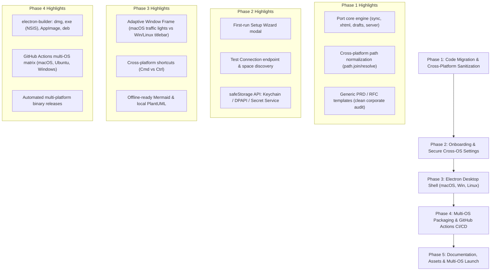

# Implementation Plan: CoNote for Confluence (Cross-Platform)

An open-source, local-first PRD & Markdown desktop notebook for Confluence Cloud supporting **macOS, Windows, and Linux**.

---

## 1. Project Overview & Target Architecture

CoNote transforms how teams write and organize Confluence documentation by providing a fast, offline-first, dual-mode desktop editor (WYSIWYG + Split Markdown) that publishes safely to Confluence Cloud without clunky web editor friction.

### Target Platforms & Deliverables:
1. **macOS:** `.dmg` installer & portable `.zip` (Universal: Apple Silicon `arm64` & Intel `x64`).
2. **Windows:** NSIS Installer (`.exe`) & Portable executable (x64 & arm64).
3. **Linux:** `.AppImage`, `.deb`, and `.rpm` packages (x64 & arm64).
4. **Core Open-Source Repo:** Clean, sanitized codebase under the MIT License with generic PRD/TAD templates.
5. **Cross-Platform Security:** OS-native encrypted credential storage (macOS Keychain, Windows DPAPI, Linux Secret Service API).

---

## 2. Phased Roadmap

---

### Phase 1: Code Migration & Cross-Platform Sanitization
- [x] **1.1. Port Core Modules:**
  - Copy core conversion engines: `storage2md.js`, `xhtml.js`, `render.js`, `publish.js`, `sync.js`, `drafts.js`, `history.js`, `confluence.js`, `move.js`, `docx.js`.
  - Copy frontend client assets: `web/index.html`, `web/app.js`, `web/style.css`, and related assets.
- [x] **1.2. Cross-Platform Path & OS Normalization:**
  - Audit all file access logic to eliminate hardcoded POSIX `/` assumptions, using `path.join()`, `path.resolve()`, and `path.normalize()`.
  - Use Electron's `app.getPath('userData')` and `app.getPath('documents')` to resolve platform-standard storage locations:
    - **macOS:** `~/Documents/CoNote/` & `~/Library/Application Support/CoNote/`
    - **Windows:** `%USERPROFILE%\Documents\CoNote\` & `%APPDATA%\CoNote\`
    - **Linux:** `~/Documents/CoNote/` & `~/.config/conote/` (or `$XDG_CONFIG_HOME`)
- [x] **1.3. Complete Corporate Sanitization:**
  - Decouple all proprietary references (e.g., hardcoded company domains, specific internal space keys, proprietary corporate emails).
  - Create industry-standard generic templates:
    - *Agile PRD Template* (Problem statement, User stories, Out of scope, Success metrics, Open questions).
    - *Technical Architecture Document (TAD / RFC)* (System overview, Architecture diagram, Sequence flow, Data models, Rollout plan).
- [x] **1.4. Clean npm package setup:**
  - Create clean `package.json` for `conote` with cross-platform scripts and permissive dependencies (MIT).

---

### Phase 2: Onboarding GUI & Cross-Platform Secure Storage
- [ ] **2.1. First-Run Setup Wizard:**
  - Detect when no spaces are configured on launch.
  - Display an interactive Setup Modal:
    1. Atlassian Cloud URL (e.g., `https://your-domain.atlassian.net/wiki`).
    2. Atlassian Account Email.
    3. API Token with direct link to [Atlassian API Tokens](https://id.atlassian.com/manage-profile/security/api-tokens).
    4. Button: **"Test Connection & Discover Spaces"**.
- [ ] **2.2. Test Connection & Auto-Discovery Endpoint:**
  - Implement `/api/test-connection` endpoint that verifies authentication against `GET /wiki/rest/api/space`.
  - Automatically populate the Space dropdown with spaces accessible to the user.
- [ ] **2.3. Workspace Folder Selection:**
  - Pre-fill platform-friendly default document path with native folder chooser button (`dialog.showOpenDialog`).
  - Automatically scaffold subdirectories (`workspace/`, `drafts/`, `templates/`, `exports/`).
- [ ] **2.4. Cross-Platform Secure Token Storage (`safeStorage`):**
  - Implement token encryption using Electron's native `safeStorage`:
    - **macOS:** Stores encryption key in macOS Keychain.
    - **Windows:** Encrypted via Windows DPAPI (Data Protection API).
    - **Linux:** Uses FreeDesktop Secret Service API (`libsecret` / GNOME Keyring / KWallet).
  - Provide fallback encrypted storage with machine-derived entropy if keyring daemon is unavailable on headless Linux.

---

### Phase 3: Desktop Shell Integration (macOS, Windows, Linux)
- [ ] **3.1. Electron Process Architecture:**
  - Setup `electron/main.js` and `electron/preload.js`.
  - Main process boots the local Node server and manages native IPC.
  - **Adaptive Window Frame:**
    - macOS: `titleBarStyle: 'hiddenInset'` (native traffic lights).
    - Windows & Linux: Native window decorations or custom frameless header with minimize/maximize/close buttons matching OS theme.
- [ ] **3.2. Cross-Platform Shortcuts & Menu:**
  - Key bindings adapt automatically:
    - `⌘N` (macOS) / `Ctrl+N` (Windows/Linux) - New Page
    - `⌘K` (macOS) / `Ctrl+K` (Windows/Linux) - Quick Search
    - `⌘P` (macOS) / `Ctrl+P` (Windows/Linux) - Publish
    - `⌘S` (macOS) / `Ctrl+S` (Windows/Linux) - Save Draft
  - Cross-platform auto-start on login using Electron's `app.setLoginItemSettings({ openAtLogin: true })` (replacing macOS-only `launchd` scripts).
- [ ] **3.3. Self-Contained Diagram Rendering:**
  - Shift Mermaid rendering to client-side Webview/Canvas rendering, eliminating the hard dependency on an external Google Chrome binary path.
  - Provide cross-platform fallback for PlantUML (local binary or configurable server).

---

### Phase 4: Multi-OS Packaging & GitHub Actions CI/CD
- [ ] **4.1. Packaging Configuration (`electron-builder`):**
  - Configure `electron-builder.yml` with targets:
    - **macOS:** `dmg`, `zip` (Universal `arm64` + `x64`).
    - **Windows:** `nsis` (custom install wizard), `portable` (`.exe`).
    - **Linux:** `AppImage` (one-click run), `deb` (Debian/Ubuntu), `rpm` (Fedora/RHEL).
- [ ] **4.2. Code Signing & Gatekeeper Strategy:**
  - macOS: Instructions for running unsigned open-source applications (`xattr -cr /Applications/CoNote.app`).
  - Windows: Instructions for SmartScreen ("More info $\rightarrow$ Run anyway") or open-source EV signing if sponsored.
  - Linux: Executable permissions for `.AppImage` (`chmod +x`).
- [ ] **4.3. GitHub Actions Multi-OS Matrix (`release.yml`):**
  - Automated CI matrix running on:
    - `macos-latest` $\rightarrow$ builds `.dmg` & `.zip`
    - `windows-latest` $\rightarrow$ builds `.exe` (NSIS & Portable)
    - `ubuntu-latest` $\rightarrow$ builds `.AppImage`, `.deb`, `.rpm`
  - Automatically compiles and attaches all installers and SHA256 checksums to GitHub Releases on tag push (`v*.*.*`).

---

### Phase 5: Documentation, Assets & Multi-OS Distribution
- [ ] **5.1. Visual Assets & Screenshots:**
  - Multi-OS screenshot previews (showing CoNote running on macOS dark mode, Windows 11, and Linux GNOME/KDE).
  - 5-second animated GIF showing "Draft locally $\rightarrow$ Publish $\rightarrow$ Live in Confluence".
- [ ] **5.2. Package Manager Distribution:**
  - **macOS:** Homebrew Cask (`brew install --cask conote`).
  - **Windows:** Windows Package Manager (`winget install muhakmal.conote`) / Scoop manifest.
  - **Linux:** AUR package (`PKGBUILD`) / Flathub or Snap submission.
- [ ] **5.3. Open Source Community Setup:**
  - Multi-OS troubleshooting guide in `docs/TROUBLESHOOTING.md`.
  - `CONTRIBUTING.md` with instructions for dev environment on macOS, Windows (PowerShell/WSL), and Linux.

---

## 3. Success Metrics

1. **Cross-Platform Availability:** 1-click installer available for macOS (.dmg), Windows (.exe), and Linux (.AppImage/.deb).
2. **Setup Time:** A new user on any OS can install the app, enter their token, and pull their first space in $< 2$ minutes.
3. **Zero Leaked Data:** 100% clean codebase with zero corporate traces.
4. **Publish Reliability:** 100% valid XHTML storage format delivered to Confluence API with zero malformed XML errors across all platforms.
