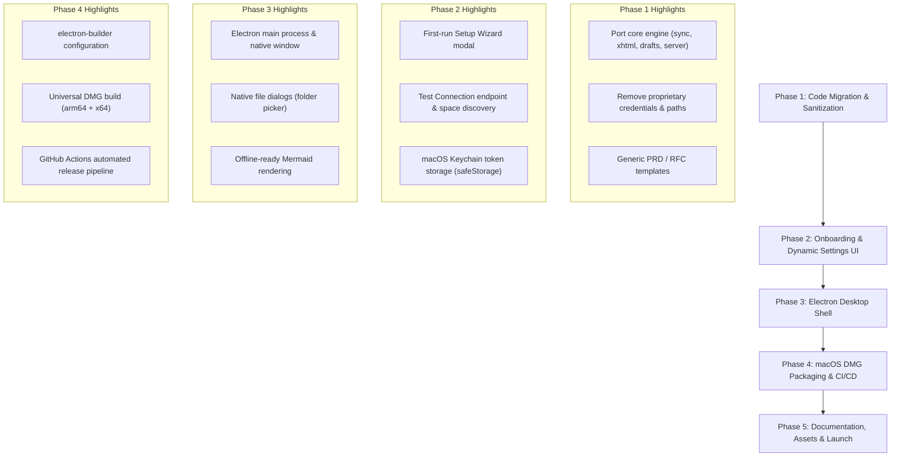

# Implementation Plan: CoNote for Confluence

An open-source, local-first PRD & Markdown desktop notebook for Confluence Cloud.

---

## 1. Project Overview & Target Architecture

CoNote transforms how teams write and organize Confluence documentation by providing a fast, offline-first, dual-mode desktop editor (WYSIWYG + Split Markdown) that publishes safely to Confluence Cloud without clunky web editor friction.

### Deliverables:
1. **Open-Source Repository:** Clean, sanitized codebase under the MIT License with generic PRD/TAD templates.
2. **First-Run Onboarding GUI:** In-app setup wizard for Atlassian Cloud connection, API token validation, space discovery, and folder configuration.
3. **Standalone Desktop Application:** macOS `.dmg` installer (Universal: Apple Silicon `arm64` & Intel `x64`).
4. **Developer Ecosystem:** Documentation, screenshots, issue templates, and Homebrew Cask distribution.

---

## 2. Phased Roadmap

---

### Phase 1: Code Migration & Sanitization (Clean Foundation)
- [ ] **1.1. Port Core Modules:**
  - Copy core conversion engines: `storage2md.js`, `xhtml.js`, `render.js`, `publish.js`, `sync.js`, `drafts.js`, `history.js`, `confluence.js`, `move.js`, `docx.js`.
  - Copy frontend client assets: `web/index.html`, `web/app.js`, `web/style.css`, and related assets.
- [ ] **1.2. Complete Sanitization:**
  - Decouple all proprietary references (e.g., hardcoded company domains, specific internal space keys, proprietary corporate emails).
  - Convert `spaces.json` to an empty template structure initialized on first launch in user's application data directory (`~/Library/Application Support/CoNote/`).
  - Create industry-standard generic templates:
    - *Agile PRD Template* (Problem statement, User stories, Out of scope, Success metrics, Open questions).
    - *Technical Architecture Document (TAD / RFC)* (System overview, Architecture diagram, Sequence flow, Data models, Rollout plan).
- [ ] **1.3. Clean npm package setup:**
  - Create clean `package.json` for `conote` with appropriate versioning, dependencies, and license.

---

### Phase 2: Onboarding GUI & Dynamic Configuration
- [ ] **2.1. First-Run Setup Wizard:**
  - Detect when no spaces are configured on launch.
  - Display an interactive Setup Modal:
    1. Atlassian Cloud URL (e.g., `https://your-domain.atlassian.net/wiki`).
    2. Atlassian Account Email.
    3. API Token with direct link to [Atlassian API Tokens](https://id.atlassian.com/manage-profile/security/api-tokens).
    4. Button: **"Test Connection & Discover Spaces"**.
- [ ] **2.2. Test Connection & Auto-Discovery Endpoint:**
  - Implement `/api/test-connection` endpoint that verifies authentication against `GET /wiki/rest/api/space`.
  - Automatically populate the Space dropdown with spaces accessible to the user.
- [ ] **2.3. Workspace Folder Selection:**
  - Default to `~/Documents/CoNote/` (or user-chosen directory).
  - Automatically scaffold subdirectories (`workspace/`, `drafts/`, `templates/`, `exports/`).
- [ ] **2.4. Secure Token Storage:**
  - Integrate Electron `safeStorage` (or `keytar`) to persist the Atlassian API token encrypted in the macOS Keychain instead of storing plaintext tokens on disk.

---

### Phase 3: Desktop Shell Integration (Electron)
- [ ] **3.1. Electron Process Architecture:**
  - Setup `electron/main.js` and `electron/preload.js`.
  - Main process starts the background Node HTTP server or bridges requests over IPC.
  - Native window creation with macOS traffic lights styling (`titleBarStyle: 'hiddenInset'`).
- [ ] **3.2. Native macOS Menu & Shortcuts:**
  - Standard macOS shortcuts (`⌘N` New Page, `⌘K` Quick Search, `⌘P` Publish, `⌘S` Save Draft).
  - Application menu items: Fetch Space, Toggle Mode, Preferences.
- [ ] **3.3. Self-Contained Diagram Rendering:**
  - Shift Mermaid rendering to client-side Webview/Canvas rendering, eliminating the hard dependency on an external Google Chrome binary path.
  - Provide fallback options for PlantUML (local binary or configurable server).

---

### Phase 4: macOS DMG Packaging & Release CI/CD
- [ ] **4.1. Packaging Configuration (`electron-builder`):**
  - Configure `electron-builder.json` / `package.json` build targets.
  - Generate `.dmg` with custom background banner, custom application icon, and drag-to-Applications shortcut.
  - Support Universal build (`arm64` for M1/M2/M3/M4 Apple Silicon and `x64` for Intel Mac).
- [ ] **4.2. Gatekeeper & Unsigned App Experience:**
  - Include documentation and helper dialog for opening unsigned open-source applications on macOS (Right-click $\rightarrow$ Open or `xattr -cr`).
- [ ] **4.3. GitHub Actions CI/CD:**
  - Build workflow `.github/workflows/build-dmg.yml` triggered on Git tag creation (`v*.*.*`).
  - Automatically attaches the compiled `.dmg` and checksums (`SHA256`) to GitHub Releases.

---

### Phase 5: Documentation, Showcase & Community Launch
- [ ] **5.1. Visual Assets & Screenshots:**
  - Professional mockups showing:
    - Interactive Space Tree & Drag-and-Drop hierarchy.
    - Dual Editor (WYSIWYG on left/right, Split Markdown).
    - Side-by-side Conflict Diff Modal before publishing.
    - First-run Onboarding Wizard.
  - 5-second animated GIF showing "Draft locally $\rightarrow$ Publish $\rightarrow$ Live in Confluence".
- [ ] **5.2. Documentation & Contributing Guides:**
  - `CONTRIBUTING.md` (How to run locally, development conventions).
  - `CODE_OF_CONDUCT.md`.
  - Issue & Pull Request templates.
- [ ] **5.3. Homebrew Cask Distribution:**
  - Prepare Homebrew formula / cask recipe (`brew install --cask conote`) for frictionless developer installation.

---

## 3. Success Metrics

1. **Setup Time:** A new user can download the DMG, enter their API token, and pull their first space in $< 2$ minutes.
2. **Zero Leaked Data:** 100% clean codebase with zero corporate traces.
3. **Offline Stability:** Ability to view, search, and draft complete PRDs while fully disconnected from the internet.
4. **Publish Reliability:** 100% valid XHTML storage format delivered to Confluence API with zero malformed XML errors.
