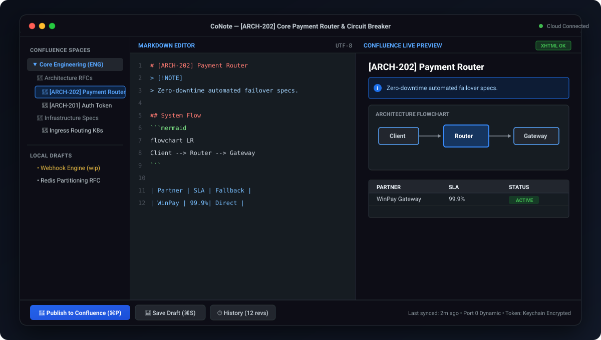
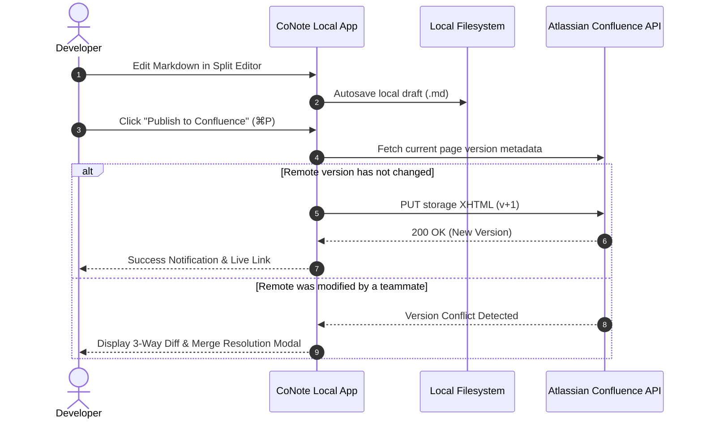

# 🌟 CoNote for Confluence — Visual Showcase & Architecture

**CoNote for Confluence** is the cross-platform, local-first PRD & technical architecture notebook designed to replace the laggy Confluence web editor with instant Markdown authoring, zero editor latency, and conflict-aware publishing.

---

## 🖥️ User Interface Overview

<div align="center">
  
</div>

<br/>

```text
┌────────────────────────────────────────────────────────────────────────────────────────┐
│  🔴 🟡 🟢  CoNote — [ARCH-202] Core Payment Router Architecture                [ ⚙️ ] │
├───────────────────┬──────────────────────────────────┬─────────────────────────────────┤
│ 📁 SPACES         │ ✍️ MARKDOWN EDITOR                │ 👁️ LIVE PREVIEW & DIAGRAMS      │
│   ▼ Core Eng (ENG)│ # [ARCH-202] Core Payment Router │ [ARCH-202] Core Payment Router  │
│     📄 Overview   │                                  │                                 │
│     ▼ RFCs        │ > [!NOTE]                        │ ℹ️ Architecture Note            │
│       📄 Router*  │ > High-throughput router specs.  │ High-throughput router specs.   │
│       📄 Cache    │                                  │                                 │
│     ▶ Archive     │ ## System Flowchart              │ System Flowchart                │
│                   │ ```mermaid                       │ ┌───────┐      ┌────────┐       │
│ 📝 LOCAL DRAFTS   │ flowchart LR                     │ │Client │ ───► │ Router │       │
│   • Auth V2 (wip) │   Client --> Router              │ └───────┘      └────────┘       │
│   • Kafka Sink    │ ```                              │                                 │
│                   │                                  │                                 │
├───────────────────┴──────────────────────────────────┴─────────────────────────────────┤
│ 🚀 [Publish to Confluence]  💾 [Save Draft (⌘S)]   🕒 [History]   📤 [Export DOCX]     │
└────────────────────────────────────────────────────────────────────────────────────────┘
```

---

## ⚡ Key Workflows

### 1. Instant Local Drafts & Conflict Prevention
Draft documents without waiting for cloud round-trips. CoNote tracks remote versions and alerts you before overwriting:



### 2. High-Fidelity Markdown $\leftrightarrow$ Confluence Storage XHTML Conversion

Unlike standard markdown converters that lose Confluence formatting, CoNote provides bi-directional mapping for enterprise Confluence macros:

| Markdown / GFM Feature | Confluence Storage XHTML Element | CoNote Behavior |
| :--- | :--- | :--- |
| `> [!NOTE]` / `> [!WARNING]` | `<ac:structured-macro ac:name="info">` / `"warning"` | Converted to native Atlassian colored panels |
| ```` ```mermaid ```` | Client-side SVG / Webview Canvas rendering | Embedded without external browser binaries |
| `| Field | Type |` | Confluence Styled Table with Header Columns | Formatted with clean border-collapse CSS |
| Frontmatter metadata | `<ac:structured-macro ac:name="details">` | Confluence Page Properties macro for report indexing |
| `@username` / `//2026-10-16` | `<ac:link><ri:user .../>` / `<time datetime="..."/>` | Converted to native mentions & date chips |
| `toc: true` | `<ac:structured-macro ac:name="toc"/>` | Native dynamic table of contents |

---

## 🔒 Security & Local-First Philosophy

```mermaid
flowchart TD
    User["👨‍💻 User Workspace"]

    subgraph DesktopApp ["CoNote Desktop App (macOS / Windows / Linux)"]
        UI["Web UI Frontend (Vanilla JS / CSS)"]
        IPC["Secure IPC Bridge (contextIsolation)"]
        NodeServer["Local Node.js In-Process Server (Port 0 Dynamic)"]
        SafeStorage["OS Secure Storage (Keychain / DPAPI / Secret Service)"]
        LocalFS["Local Workspace (/drafts, /workspace, /exports)"]
    end

    CloudAPI["☁️ Atlassian Confluence Cloud (Direct HTTPS)"]

    User <--> UI
    UI <--> IPC
    IPC <--> NodeServer
    NodeServer <--> SafeStorage
    NodeServer <--> LocalFS
    NodeServer <=== "Direct HTTPS (No Middleman / No Analytics)" ===> CloudAPI
```

---

## 🚀 Keyboard Shortcuts Cheat Sheet

| Action | macOS | Windows / Linux |
| :--- | :--- | :--- |
| **New Page / Draft** | `⌘ N` | `Ctrl + N` |
| **Quick Search Pages** | `⌘ K` | `Ctrl + K` |
| **Publish to Confluence** | `⌘ P` | `Ctrl + P` |
| **Save Draft** | `⌘ S` | `Ctrl + S` |
| **Toggle Fullscreen Editor** | `⌘ ⇧ F` | `Ctrl + Shift + F` |
| **Open DevTools** | `⌘ ⌥ I` | `Ctrl + Shift + I` |
| **Reload Workspace** | `⌘ R` | `Ctrl + R` |
