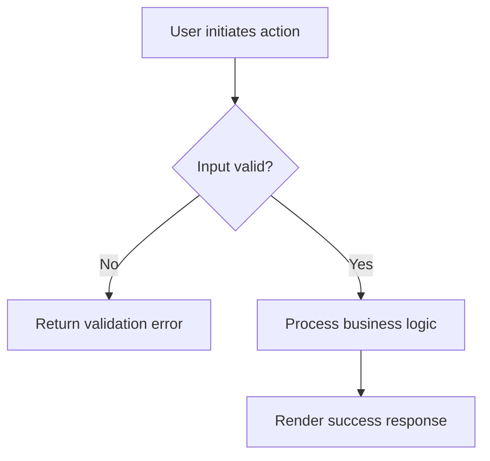
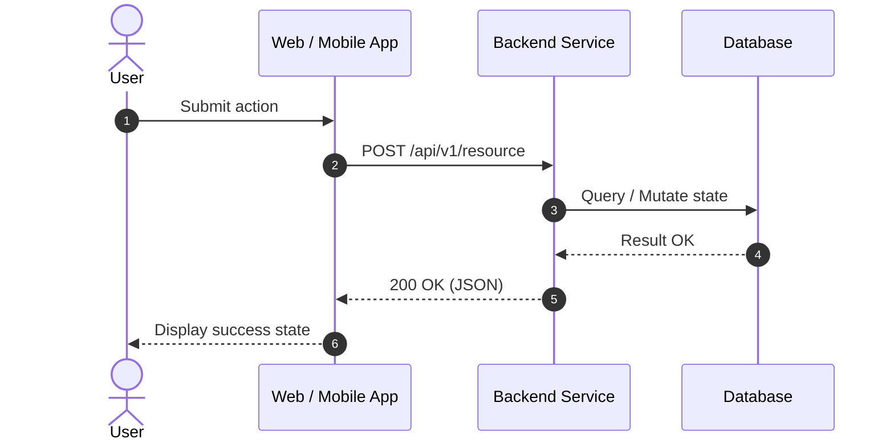

[TOC]

## Objective

Describe the user problem being solved, target audience personas, and why this is a priority now.

## Success Metrics

| Goal | Metric | Target |
| --- | --- | --- |
| Primary user or business objective | Measurement mechanism | Baseline → Target value |

## Assumptions & Dependencies

- Required third-party services or upstream API dependencies
- Business and technical assumptions

## Pre-Condition

- System and data state required prior to executing this feature

## Post-Condition

- Expected system and user state after this feature is executed

## User Journey / Flow



## Sequence Diagram



## Functional Requirements

| # | User Story | Identifier | Acceptance Criteria | Interface |
| --- | --- | --- | --- | --- |
| 1 | As a user, I want to … so that … | REQ-001 | 1. First acceptance criterion<br>2. Second acceptance criterion | UI / API |

### Non-Functional Requirements

| Category | Requirement Specification |
| --- | --- |
| Performance | API response time p95 < 250ms under peak load |
| Security | Input sanitization, authentication via Bearer token, RBAC |
| Observability | Structured logging with trace-id, OpenTelemetry metrics |

## API Specification

### Endpoint: POST `/api/v1/resource`

#### Request Headers
| Header | Value | Required | Description |
| --- | --- | --- | --- |
| Authorization | Bearer `<token>` | Yes | User authentication token |
| Content-Type | application/json | Yes | Request payload format |

#### Request Body
```json
{
  "name": "Sample Resource",
  "enabled": true
}
```

#### Response (200 OK)
```json
{
  "status": "success",
  "data": {
    "id": "res_12345",
    "createdAt": "2026-10-16T00:00:00Z"
  }
}
```

## Open Questions

| # | Question | Owner | Status | Resolution |
| --- | --- | --- | --- | --- |
| 1 | Example open question | Product Manager | OPEN | TBD |
