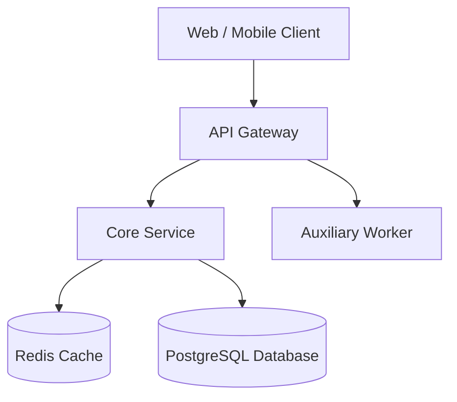
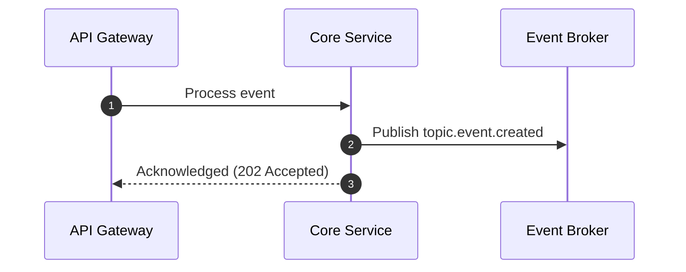

[TOC]

## Context & Problem Statement

Briefly summarize the engineering challenge, technical debt, or scalability requirement prompting this proposal.

## Proposed Architecture



## Detailed Design

### Data Model & Schema Changes

```sql
CREATE TABLE IF NOT EXISTS sample_entities (
    id UUID PRIMARY KEY DEFAULT gen_random_uuid(),
    name VARCHAR(255) NOT NULL,
    metadata JSONB DEFAULT '{}'::jsonb,
    created_at TIMESTAMPTZ NOT NULL DEFAULT NOW()
);
```

### Component Interactions & Sequence



## Alternatives Considered

| Approach | Pros | Cons | Decision |
| --- | --- | --- | --- |
| Option A (Recommended) | Low latency, horizontal scale | Higher initial setup complexity | Selected |
| Option B | Simpler implementation | Single point of failure | Rejected |

## Migration & Rollout Plan

1. **Phase 1: Shadow Traffic & Dry-Run Testing**
2. **Phase 2: Canary Deployment (5% $\rightarrow$ 25% $\rightarrow$ 100%)**
3. **Phase 3: Deprecation of Legacy Endpoints**

## Security & Observability

- **Authentication / Authorization:** Zero-trust mTLS between microservices.
- **Alerting Thresholds:** P99 latency $> 500ms$ or error rate $> 1\%$ triggers PagerDuty alert.
